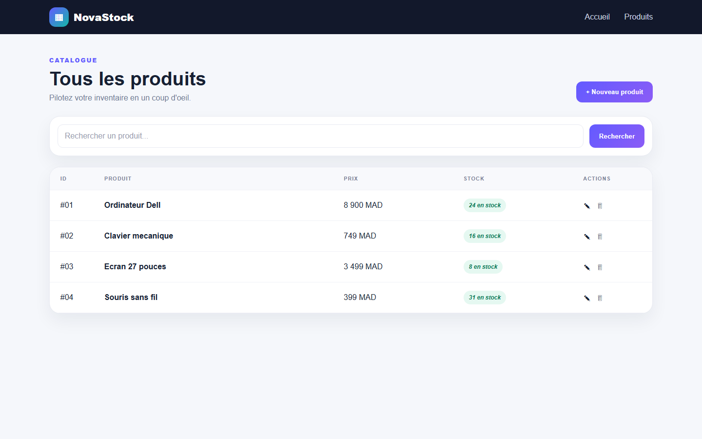
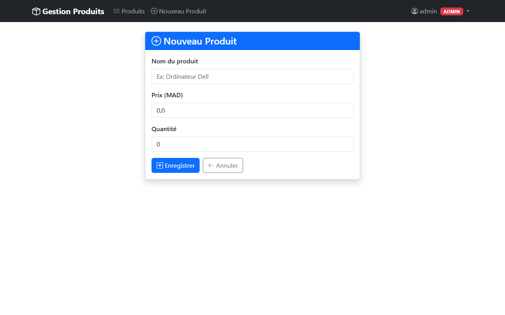
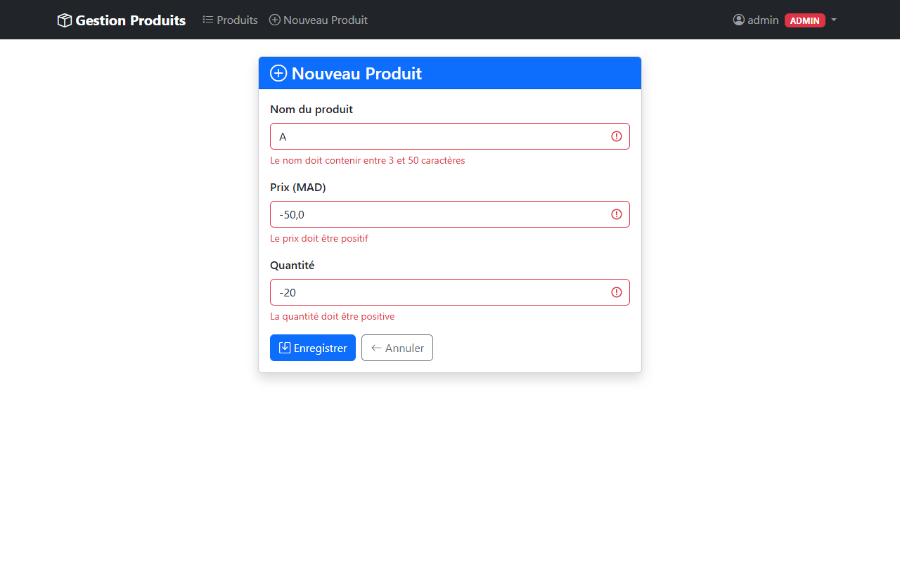
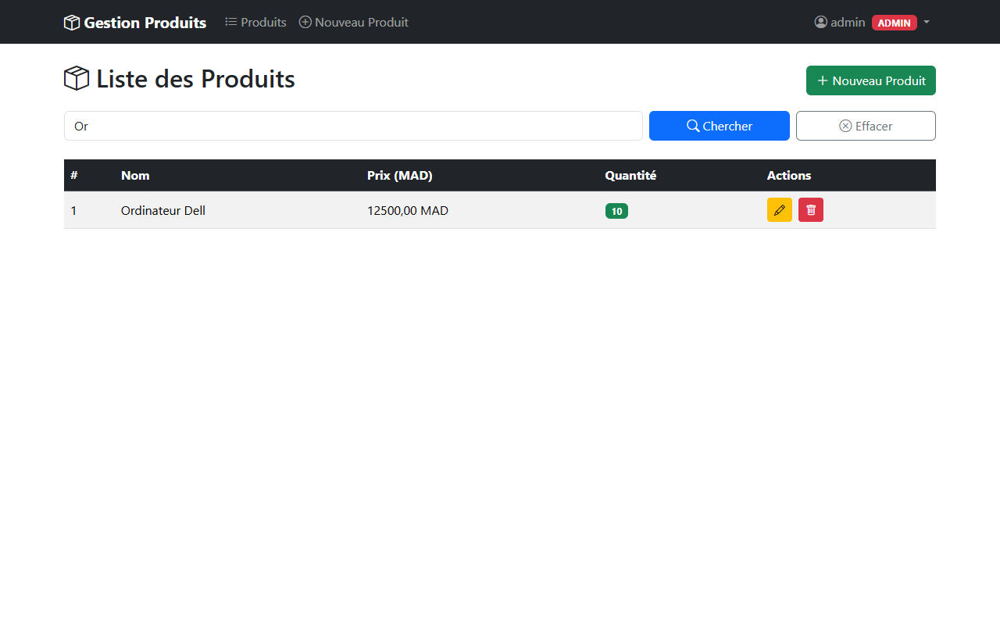
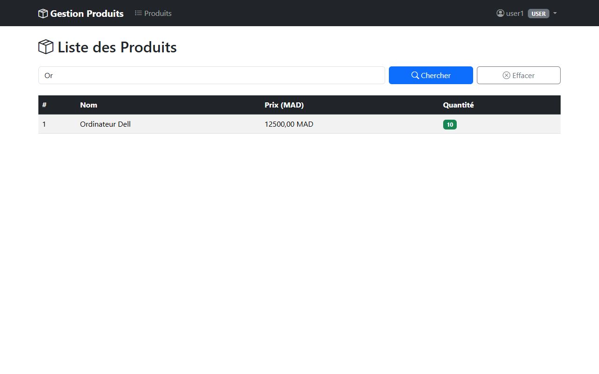

# Activite pratique 3 - Application Web Spring Boot

## Objectif

Construire une application Web MVC de gestion de produits avec rendu serveur,
validation et securisation selon le role utilisateur.

## Fonctionnalites

- Authentification par formulaire.
- Droits differents pour `USER` et `ADMIN`.
- Affichage, recherche et pagination des produits.
- Ajout et modification avec validation.
- Suppression reservee aux utilisateurs autorises.
- Pages de connexion et d'acces refuse (`403`).
- Gabarit reutilisable avec Thymeleaf Layout Dialect.

## Architecture

```text
src/main/java/ma/enset/
|-- controllers/    Controleurs MVC
|-- entities/       Entite Product
|-- repositories/   Acces aux donnees
`-- security/       Configuration Spring Security

src/main/resources/templates/
|-- layout/          Gabarit commun
|-- products/        Liste et formulaire
`-- security/        Connexion et page 403
```

## Execution

Java 17, Spring Boot 3.2.5, Spring MVC, Spring Data JPA, Thymeleaf,
Spring Security 6, Bean Validation et Bootstrap sont utilises.

```bash
cd tp3-webapp
mvn clean spring-boot:run
```

Ouvrez `http://localhost:8080`. Le dossier `screenshots` documente la connexion,
le CRUD, la validation, la recherche et les vues par role.

## Captures d'ecran

### Authentification


### Espace administrateur

| Liste des produits | Ajout d'un produit |
| --- | --- |
|  |  |

| Validation du formulaire | Modification |
| --- | --- |
|  |  |

### Recherche et espace utilisateur

| Recherche | Vue utilisateur |
| --- | --- |
|  |  |

[Retour au README principal](../README.md)
