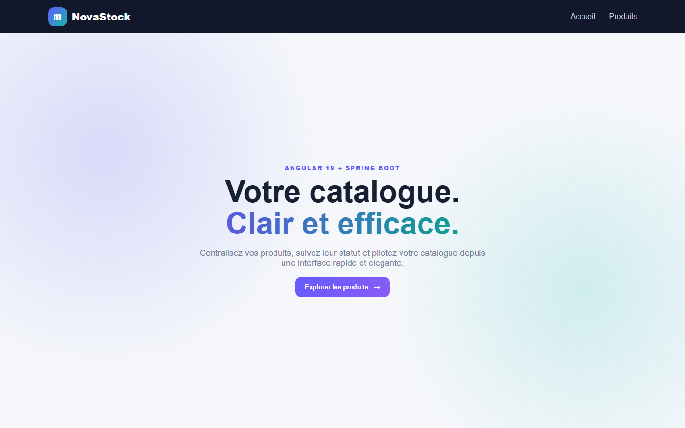
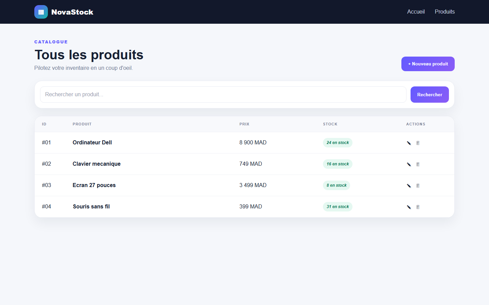
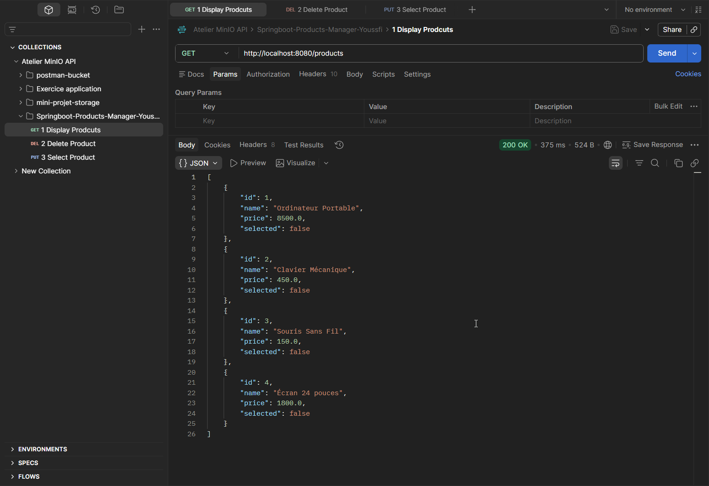
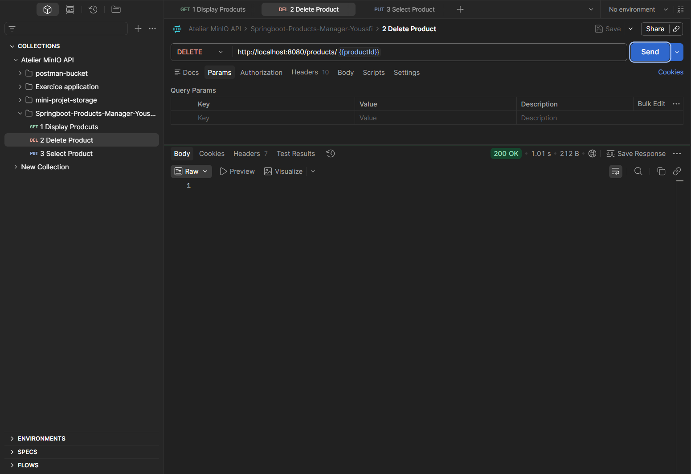
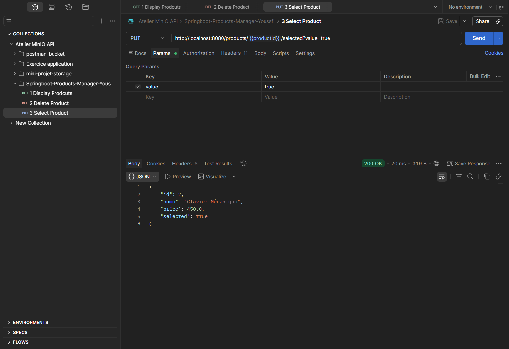
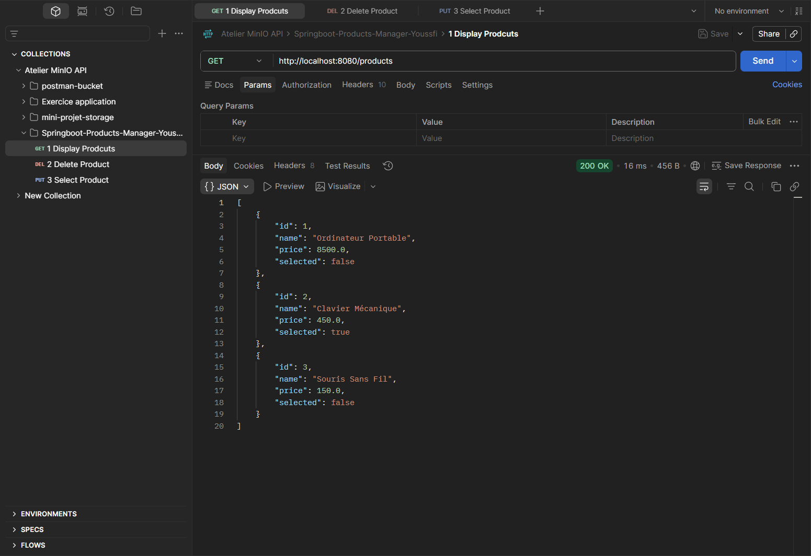

# Activite pratique 4 - Angular Framework

## Objectif

Developper une application full-stack de gestion de produits avec une API REST
Spring Boot et une interface monopage Angular.

## Backend Spring Boot

Le dossier `backend` contient une entite `Product`, un repository Spring Data,
un controleur REST CRUD et une base H2 initialisee par `data.sql`.

```bash
cd backend
mvn clean spring-boot:run
```

## Frontend Angular

Le dossier `frontend` contient les pages d'accueil et de produits, le routage,
un service HTTP et une interface Bootstrap.

```bash
cd frontend
npm install
npm start
```

Ouvrez `http://localhost:4200` en gardant le backend actif.

## Architecture

```text
Navigateur -> composants Angular -> ProductService -> API REST Spring Boot
                                                    -> Spring Data JPA -> H2
```

## Verification

```bash
# Dans frontend
npm test
npm run build

# Dans backend
mvn test
```

Le dossier `screenshots` illustre l'accueil, les produits et les requetes GET,
PUT et DELETE.

## Captures d'ecran

### Interface Angular

| Page d'accueil | Liste des produits |
| --- | --- |
|  |  |

### Verification de l'API REST

| Requete GET | Requete DELETE |
| --- | --- |
|  |  |

| Apres suppression | Requete PUT |
| --- | --- |
|  |  |



[Retour au README principal](../README.md)
